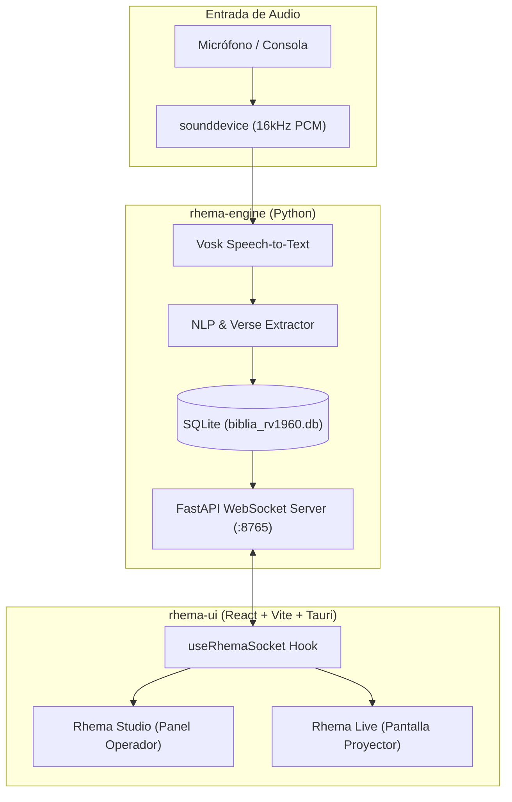

# Rhema (ῥῆμα) — Proyector Bíblico Inteligente

<div align="center">


**Sistema inteligente y de ultra-baja latencia para la detección y proyección automática de citas bíblicas mediante voz en tiempo real.**

[](https://react.dev/)
[](https://www.typescriptlang.org/)
[](https://vitejs.dev/)
[](https://tailwindcss.com/)
[](https://www.python.org/)
[](https://fastapi.tiangolo.com/)
[](https://v2.tauri.app/)
[](https://www.sqlite.org/)
[](LICENSE)

[🌐 Ver Demo Web en Vivo](#-despliegue-y-demo-en-vivo) • [📦 Descargar para Windows](#-instalador-de-escritorio) • [📖 Arquitectura](#-arquitectura-del-sistema)

</div>

---

## ✨ Características Principales

- 🎙️ **Reconocimiento de Voz Offline y Local:** Transcripción de audio continua y privada impulsada por **Vosk** sin costos de API por segundo ni latencia de red.
- ⚡ **Extracción Inteligente de Citas (NLP & Regex):** Normaliza números hablados (*"uno", "primer" -> "1"*) e identifica al instante referencias bíblicas canónicas (ej. *"san juan capítulo tres versículo dieciséis"* -> *"Juan 3:16"*).
- 📖 **Base de Datos Bíblica Integrada:** Motor ultrarrápido sobre **SQLite** con la versión Reina-Valera 1960 (>31,100 versículos indexados).
- 🖥️ **Proyección Dual / Multi-Pantalla:**
  - **Rhema Studio:** Panel de control para el operador con transcripción en directo, historial de citas detectadas y control manual.
  - **Rhema Live (Proyector):** Ventana de proyección sin bordes, optimizada para pantallas gigantes o transmisión en vivo (OBS / NDI / HDMI).
- 🌐 **Híbrido Web & Desktop:** Ejecutable nativo ultra ligero gracias a **Tauri v2** y versión Web lista para desplegar en cualquier navegador moderno.

---

## 🏗️ Arquitectura del Sistema



---

## 🚀 Despliegue y Demo en Vivo

- **Aplicación Web:** [https://israelhuamanh.github.io/rhema/](https://israelhuamanh.github.io/rhema/)
- **Modo Proyector Web:** [https://israelhuamanh.github.io/rhema/?window=projector](https://israelhuamanh.github.io/rhema/?window=projector)

---

## 📦 Instalador de Escritorio

Si buscas la experiencia nativa de escritorio con latencia cero y procesamiento 100% offline:

👉 **[Descargar Rhema para Windows (.exe)](https://github.com/israelhuamanh/rhema/releases/latest)** *(Disponible en la pestaña de Releases)*

---

## 🛠️ Desarrollo Local

### Requisitos Previos

- **Node.js** (v18 o superior) y `npm`
- **Python** (v3.10 o superior)
- **Rust & Cargo** (solo si compilas la versión de escritorio con Tauri)

### 1. Backend (`rhema-engine`)

```bash
cd rhema-engine
python -m venv venv

# En Windows:
.\venv\Scripts\activate

# Instalar dependencias
pip install -r requirements.txt

# Iniciar servidor
python src/main.py
```

### 2. Frontend (`rhema-ui`)

```bash
cd rhema-ui
npm install

# Modo desarrollo web
npm run dev

# Modo aplicación de escritorio nativa (Tauri)
npm run tauri dev
```

---

## 📂 Estructura del Repositorio

```text
rhema/
├── rhema-engine/                # Backend en Python (Audio, STT, NLP, SQLite, WebSockets)
│   ├── database/                # Base de datos SQLite y script de población (seed.py)
│   ├── models/                  # Modelo Vosk en español
│   └── src/                     # Lógica central del motor
├── rhema-ui/                    # Frontend React + TypeScript + Tailwind
│   ├── src/                     # Componentes y ventanas (Studio y Projector)
│   └── src-tauri/               # Configuración del núcleo de escritorio Tauri v2
└── arquitectura_proyector_biblico.md # Especificación técnica detallada
```

---

## 📄 Licencia

Este proyecto está bajo la Licencia [MIT](LICENSE).
